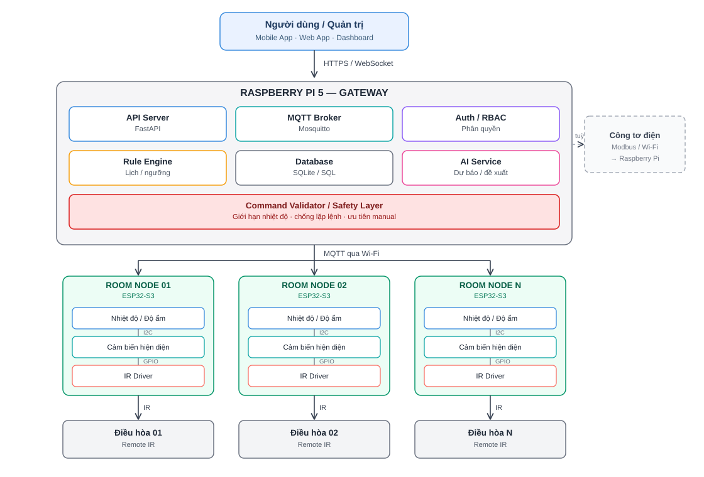

# Smart AC Controller — IoT + ML for Daikin air conditioners

[](https://github.com/<YOUR_USERNAME>/pbl5-smart-ac/actions)


A room-level smart air-conditioning system: **ESP32-S3 room nodes** sense temperature, humidity and presence and drive a **Daikin** AC over infrared; a **Raspberry Pi 5 gateway** collects data over MQTT, enforces compressor-safety rules, and (later) learns the user's comfort preferences to *suggest* settings.

> University PBL5 project (Computer Systems course). The human always has the final say: local remote > app > rules > AI.



## Why this design

| Decision | Reason |
|---|---|
| IR control instead of tapping the AC's internal bus | Works with any Daikin remote-controlled unit, no warranty-voiding hardware changes |
| IR **receiver** next to the transmitter ("remote eavesdropping") | IR is one-way; overhearing the physical remote keeps the system's state estimate honest |
| mmWave presence (HLK-LD2410) rather than PIR | Detects stationary people (sleeping, reading), where PIR drops out |
| MQTT with per-room ACL | Each node can only touch `home/<its own room>/…` |
| Safety Layer between AI and AC | Hysteresis, minimum off-time and rate limits protect the compressor, whatever the AI proposes |
| AI as *suggestion* (Manual / Suggest / Auto) | Avoids annoying the user; trust is earned progressively |

Details: [docs/ARCHITECTURE.md](docs/ARCHITECTURE.md).

## Project status (honest)

| Milestone | Scope | Status |
|---|---|---|
| 1 | ESP32 ⇄ MQTT ⇄ Pi, SQLite storage, auth + ACL | Gateway **tested** on a real Mosquitto broker with a simulated node; firmware written, CI compiles it, not yet validated on hardware |
| 2 | Daikin IR decode + transmit | Planned |
| 3 | Real sensors: SHT41 (I²C), LD2410 (UART) | Planned |
| 4 | Safety Layer + REST API (FastAPI) | Planned |
| 5 | Dashboard / app | Planned |
| 6 | Data collection + comfort model (scikit-learn) | Planned |

Measured in Milestone 1 (simulated node, same machine — not a Wi-Fi benchmark): command → result round trip **9–43 ms**; invalid telemetry is rejected and logged; cross-room publish and wrong-password connections are blocked by the broker.

## Repository layout

```
firmware/room_node/   ESP32-S3 Arduino sketch (config.example.h -> config.h)
gateway/              Raspberry Pi services, Mosquitto config, tests
docs/                 Architecture, Vietnamese setup guide, diagrams
.github/workflows/    CI: ruff + pytest + firmware compile
```

## Quick start (no hardware needed)

```bash
sudo apt install mosquitto mosquitto-clients
cd gateway
python3 -m venv .venv && source .venv/bin/activate
pip install -r requirements.txt
cp .env.example .env            # set MQTT_PASS
python gateway.py               # terminal 1
python simulate_node.py --room room01 --password <pw> --interval 5   # terminal 2
python send_command.py --room room01 --power on --mode cool --temp 26 --fan auto  # terminal 3
python show_data.py
```

Broker setup (password file + ACL) and ESP32 flashing: see the step-by-step guide in Vietnamese, [docs/SETUP.vi.md](docs/SETUP.vi.md).

## MQTT topics

| Topic | Direction | Payload |
|---|---|---|
| `home/{room}/telemetry` | node → gateway | `{"seq","temp","hum","presence","sim","rssi","uptime_s"}` |
| `home/{room}/command` | gateway → node | `{"cmd_id","power","mode","temp","fan","source","ts"}` |
| `home/{room}/command_result` | node → gateway | `{"cmd_id","ok","ir_sent","note"}` |
| `home/{room}/status` | node → gateway | `online` / `offline` (retained, Last Will) |

## Development

```bash
pip install -r gateway/requirements.txt pytest ruff
ruff check . && pytest -q
```

Commits follow [Conventional Commits](https://www.conventionalcommits.org/) (`feat:`, `fix:`, `docs:`, `test:`, `ci:`); releases are tagged `vMAJOR.MINOR.PATCH` — see [CHANGELOG.md](CHANGELOG.md).

## Security notes

- Real credentials live only in `gateway/.env` and `firmware/room_node/config.h`, both git-ignored. Use the `*.example` templates.
- The broker listens without TLS on the LAN (acceptable for a prototype). For anything beyond that, enable TLS and don't expose port 1883 to the internet.

## License

MIT — see [LICENSE](LICENSE).
