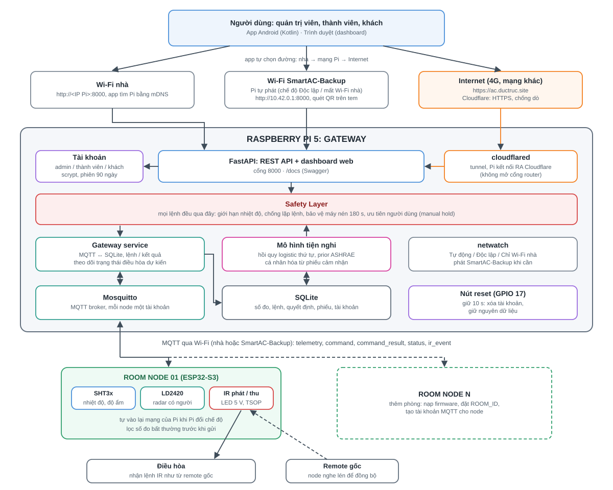
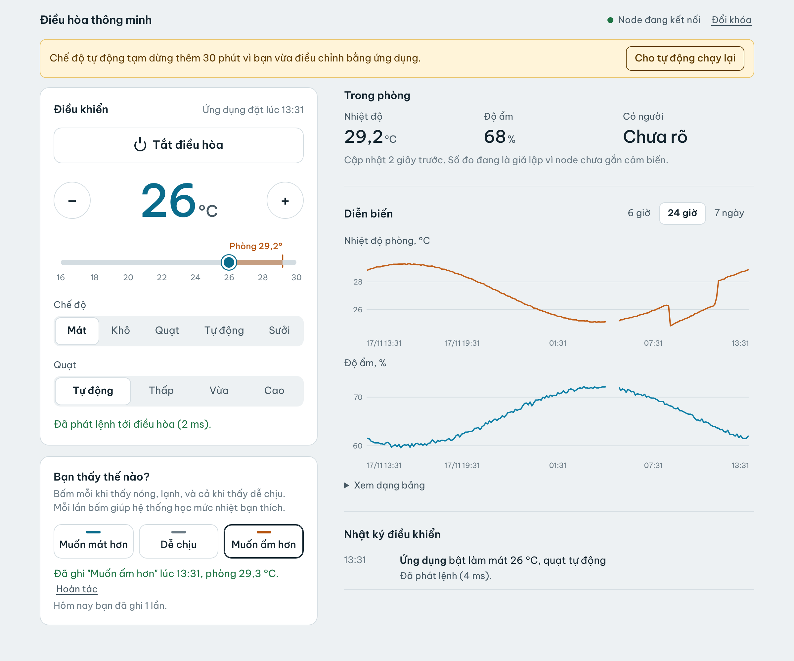
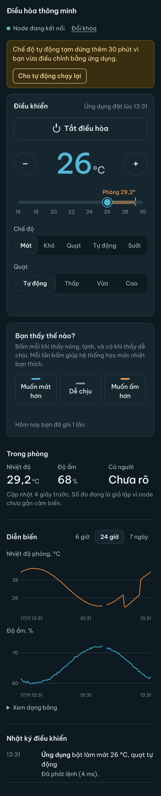
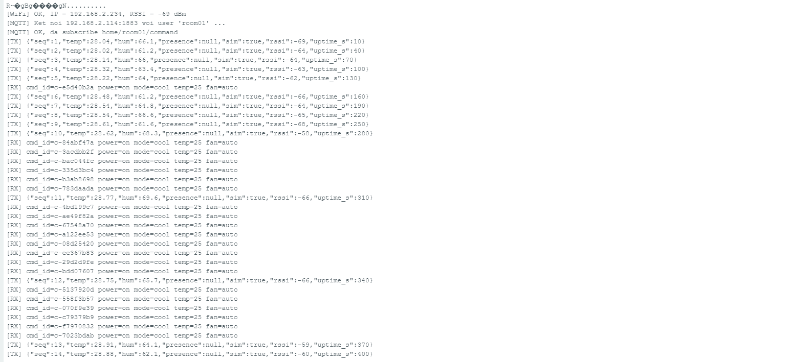

# Smart AC Controller — IoT + ML for Daikin air conditioners

[](https://github.com/<nguyenductruc-04>/pbl5-smart-ac/actions)


A room-level smart air-conditioning system: **ESP32-S3 room nodes** sense temperature, humidity and presence and drive a **Daikin** AC over infrared; a **Raspberry Pi 5 gateway** collects data over MQTT, enforces compressor-safety rules, and (later) learns the user's comfort preferences to *suggest* settings.

> University PBL5 project (Computer Systems course). The human always has the final say: local remote > app > rules > AI.



## Why this design

| Decision | Reason |
|---|---|
| IR control instead of tapping the AC's internal bus | Works with any Daikin remote-controlled unit, no warranty-voiding hardware changes |
| IR **receiver** next to the transmitter ("remote eavesdropping") | IR is one-way; overhearing the physical remote keeps the system's state estimate honest |
| mmWave presence (HLK-LD2420) rather than PIR | Detects stationary people (sleeping, reading), where PIR drops out |
| MQTT with per-room ACL | Each node can only touch `home/<its own room>/…` |
| Safety Layer between AI and AC | Hysteresis, minimum off-time and rate limits protect the compressor, whatever the AI proposes |
| AI as *suggestion* (Manual / Suggest / Auto) | Avoids annoying the user; trust is earned progressively |
| mDNS discovery (`gateway.local`) instead of a hard-coded IP | Gateway IP can change (DHCP, network switch) without re-flashing nodes |

Details: [docs/ARCHITECTURE.md](docs/ARCHITECTURE.md).

## Project status (honest)

| Milestone | Scope | Status |
|---|---|---|
| 1 | ESP32 ⇄ MQTT ⇄ Pi, SQLite storage, auth + ACL | ✅ Done — validated on ESP32-S3 + Raspberry Pi 5 over Wi-Fi |
| 2 | Daikin IR decode + transmit | ✅ Done — send/receive validated by IR loopback (17/20, TSOP38238); **pending test on a real Daikin unit** |
| 2+ | Backup network: Pi backup AP, node follows the gateway, Wi-Fi provisioning over MQTT | Done (v0.4.0), tested on hardware |
| 3 | Real sensors: SHT3x (I²C), LD2420 presence | Done (v0.5.0), tested on hardware; data collection started 17-11 |
| 4 | Safety Layer + REST API (FastAPI) | Done (v0.6.0), tested on hardware |
| 5 | Web dashboard + comfort votes | Done (v0.7.0), tested on hardware |
| 6 | Comfort model + suggestions (ASHRAE prior, personalised from votes) | Done (v0.8.0); evaluation on real votes pending data |
| 6+ | Missed-IR recovery, network modes, QR pairing, user accounts with first setup by label and a reset button | v0.10.0 |

## Dashboard

Served by the Raspberry Pi itself at `http://gateway.local:8000`; works without Internet. Every command goes through the Safety Layer, and refusals are explained in plain language. Each person signs in with their own account (admin, member or guest); the first admin claims the Pi with the code on its label, and holding a button on the Pi for 10 s resets the accounts ([ADR 0007](docs/adr/0007-user-accounts.md)). The "Bạn thấy thế nào?" buttons record comfort votes, the training labels for the comfort model.

| Desktop | Phone (dark mode) |
|---|---|
|  |  |

Screenshots use a simulated node and generated history.

### Measured results

Command → result round trip on real hardware (ESP32-S3 ⇄ 2.4 GHz Wi-Fi ⇄ Mosquitto on Raspberry Pi 5).
Sensor data is still simulated (SHT3x (SHT30/SHT31) not yet fitted).

| Version | Change | N | Median | p95 | Mean | Min | Max |
|---|---|---|---|---|---|---|---|
| v0.1.0 | baseline | 21 | — | — | 427 ms | 35 ms | 1909 ms |
| v0.1.1 | Wi-Fi modem sleep disabled (`WiFi.setSleep(false)`) | 20 | **28 ms** | **38 ms** | — | 20 ms | **54 ms** |
| v0.3.0 | Real IR sent before reply (includes Daikin frame airtime) | 20 | **468 ms** | **481 ms** | — | 464 ms | 486 ms |

The v0.1.0 tail latency came from ESP32 Wi-Fi modem sleep (on by default), which delays incoming MQTT messages.
Disabling it cut worst-case latency ~35×. Trade-off: higher idle power, acceptable for mains-powered room nodes.

From v0.3.0 the node replies only after the IR frame has been sent, so round trip ≈ MQTT (median 28 ms, v0.1.1)
+ Daikin 280-bit IR frame airtime (~440 ms). The narrow spread (464–486 ms) shows the added time is a constant
set by the protocol, not network delay.

IR circuit, component calculations and loopback test results: [docs/hardware/ir-circuit.md](docs/hardware/ir-circuit.md).



## Comfort model

The gateway suggests an AC setting from a personal comfort model: an ordinal logistic regression whose population prior comes from about 20,000 votes in the ASHRAE Global Thermal Comfort Database II (tropical and monsoon climates), personalised on the Pi from the user's own "cooler / comfortable / warmer" votes. Suggestions can be applied by hand or, optionally, automatically; either way they pass the Safety Layer. Design and evaluation method: [ADR 0004](docs/adr/0004-comfort-model.md); results: [docs/ml](docs/ml/).

## Repository layout

```
firmware/room_node/   ESP32-S3 Arduino sketch (config.example.h -> config.h)
gateway/              Raspberry Pi services, Mosquitto config, tests
ml/                   Offline training and evaluation of the comfort model (laptop only)
docs/                 Architecture, Vietnamese setup guide, ADRs, diagrams
.github/workflows/    CI: ruff + pytest + firmware compile
```

## Quick start (no hardware needed)

```bash
sudo apt install mosquitto mosquitto-clients
cd gateway
python3 -m venv .venv && source .venv/bin/activate
pip install -r requirements.txt
cp .env.example .env            # set MQTT_PASS
python api.py                   # terminal 1: MQTT ingest + Safety Layer + REST API (needs API_KEY in .env)
python simulate_node.py --room room01 --password <pw> --interval 5   # terminal 2
curl -H "X-API-Key: <API_KEY>" -H "Content-Type: application/json" -d '{"power":"on","temp":26}' http://localhost:8000/api/v1/rooms/room01/commands
python show_data.py
```

Broker setup (password file + ACL) and ESP32 flashing: see the step-by-step guide in Vietnamese, [docs/SETUP.vi.md](docs/SETUP.vi.md).

## MQTT topics

| Topic | Direction | Payload |
|---|---|---|
| `home/{room}/telemetry` | node → gateway | `{"seq","temp","hum","presence","sim","rssi","uptime_s"}` —  `presence` là `true` / `false` / `null` (null = không có hoặc mất cảm biến). | 
| `home/{room}/command` | gateway → node | `{"cmd_id","power","mode","temp","fan","source","ts"}` |
| `home/{room}/command_result` | node → gateway | `{"cmd_id","ok","ir_sent","note"}` |
| `home/{room}/status` | node → gateway | `online` / `offline` (retained, Last Will) |
| `home/{room}/ir_event` | node → gateway | `{"protocol","power","mode","temp","fan","source","uptime_s"}` — user pressed the original remote |
| `home/{room}/config` | gateway → node | `{"cfg_id","wifi":{"ssid","pass"}}` (retained until answered); `{"net":"backup"\|"home"}` advance notice of a Pi network switch (not retained) |
| `home/{room}/config_result` | node → gateway | `{"cfg_id","ok","error"}` |

## REST API

Every command goes through the Safety Layer; refusals come back with a reason code and, when relevant, `Retry-After`. Interactive docs at `http://gateway.local:8000/docs`; reference in [docs/API.md](docs/API.md).

## Development

```bash
pip install -r gateway/requirements-dev.txt
```

Commits follow [Conventional Commits](https://www.conventionalcommits.org/) (`feat:`, `fix:`, `docs:`, `test:`, `ci:`); releases are tagged `vMAJOR.MINOR.PATCH` — see [CHANGELOG.md](CHANGELOG.md).

## Security notes

- Real credentials live only in `gateway/.env` and `firmware/room_node/config.h`, both git-ignored. Use the `*.example` templates.
- The broker listens without TLS on the LAN (acceptable for a prototype). For anything beyond that, enable TLS and don't expose port 1883 to the internet.

## License

MIT — see [LICENSE](LICENSE).
