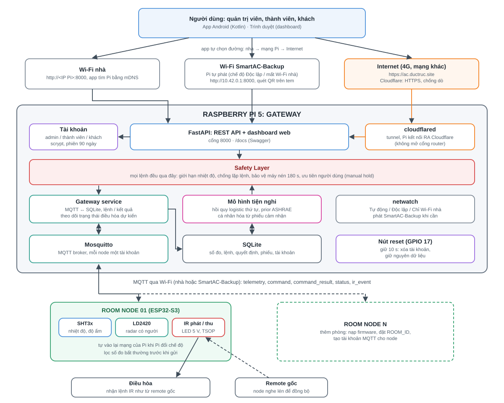
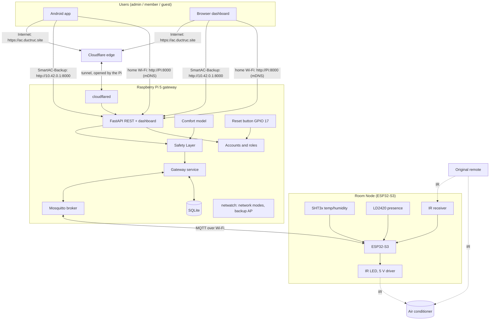

# Architecture

Status (v0.10.0): everything above is implemented and tested on the hardware. Not done yet: decoding the Casper remote protocol, a range test on a real air conditioner, and evaluating the comfort model on enough real votes.

## Access paths

The phone reaches the same API three ways and the Android app picks the first that answers, in this order ([ADR 0008](adr/0008-remote-access.md)):

| Path | Address | Needs |
|---|---|---|
| Home Wi-Fi | `http://<Pi>:8000`, found by mDNS (`_pbl5._tcp`) | Phone on the home network |
| Backup network | `http://10.42.0.1:8000` | Pi broadcasting `SmartAC-Backup` (standalone mode, or home Wi-Fi lost); the app joins it from the QR on the label |
| Internet | `https://ac.ductruc.site` | Home Internet; Cloudflare Tunnel opened by the Pi, no inbound port |

The session token is valid on all three, so switching networks needs no new sign-in. First setup of a new or reset Pi is refused over the Internet.

## Accounts

Roles admin / member / guest; the first admin claims the Pi with the code on its label, others register and wait for approval; holding the reset button 10 s deletes all accounts and keeps the data ([ADR 0007](adr/0007-user-accounts.md)). The `API_KEY` in `.env` keeps admin rights for scripts on the Pi.

## Network modes

`netwatch` (root service) applies the mode chosen on the dashboard or in the app: **auto** (home Wi-Fi, backup AP after 2 min without it), **standalone** (always the backup AP) or **home** (never the AP). Nodes remember the last network that worked and follow a not-retained `{"net": ...}` hint sent before a switch ([ADR 0006](adr/0006-field-network-and-device-pairing.md)).

## Control priority and Safety Layer

Every command passes one pure function, `safety.evaluate()`, before it is published. Decisions and their reason codes are logged. Full rule table and rationale: [ADR 0002](adr/0002-safety-layer-and-control-api.md).

- **Manual sources** (`remote`, `app`): the last human action wins and starts an auto-hold (60 / 30 min).
- **Automatic sources** (`rule`, `ai`): blocked during the hold or while the AC state is uncertain; limited to 24–29 °C, 1 °C per step, one command per 10 min, fresh telemetry, never power-on in an empty room.
- **Compressor protection**: 180 s minimum off-time for every source.
- **A person can always turn the unit off.**
- Never cut AC power with a relay; IR only.
- State is *expected*, not confirmed (IR is one-way); resynchronised when the remote is overheard, and flagged uncertain after any gap (node offline, command timeout, gateway restart).
- Commands are never queued for an offline node.

## Data flow

**Request:** app or browser → FastAPI (session token or API key → role) → Safety Layer (commands) → gateway → MQTT.

**Telemetry:** sensor → ESP32 plausibility filter (range, ≤5 °C jump) → `home/<room>/telemetry` (QoS 0) → gateway re-validates → SQLite (invalid messages go to `rejected`).

**Command:** source → REST API → Safety Layer → `home/<room>/command` (QoS 1) → node → IR → `command_result` → gateway stores round-trip time.

**Availability:** node publishes `status=online` (retained); broker publishes `offline` via Last Will if the node vanishes.

## Comfort model (Milestone 6)

The original plan (Random Forest on manual AC adjustments) changed because the room with the node has no AC: labels now come from comfort votes on the dashboard. The model is an ordinal logistic regression with a population prior from the ASHRAE Global Thermal Comfort Database II, personalised on the Pi from the user's votes, and deployed in stages: suggestions first, optional automatic mode later, always through the Safety Layer. Details and evaluation: [ADR 0004](adr/0004-comfort-model.md), [docs/ml](ml/).
