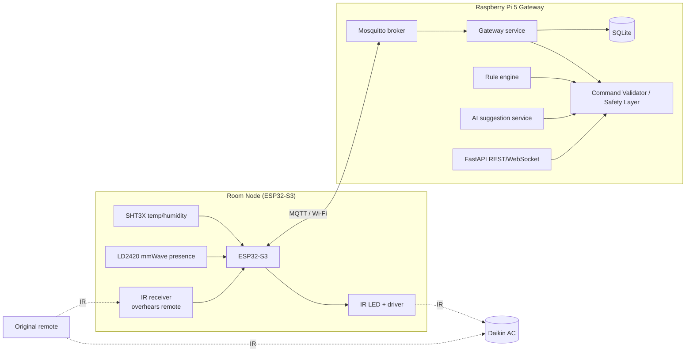

# Architecture

The Safety Layer and REST API are implemented (v0.6.0); the rule engine, AI service and dashboard are **planned**.

## Control priority and Safety Layer

Every command passes one pure function, `safety.evaluate()`, before it is published. Decisions and their reason codes are logged. Full rule table and rationale: [ADR 0002](adr/0002-safety-layer-and-control-api.md).

- **Manual sources** (`remote`, `app`): the last human action wins and starts an auto-hold (60 / 30 min).
- **Automatic sources** (`rule`, `ai`): blocked during the hold or while the AC state is uncertain; limited to 24–29 °C, 1 °C per step, one command per 10 min, fresh telemetry, never power-on in an empty room.
- **Compressor protection**: 180 s minimum off-time for every source.
- **A person can always turn the unit off.**
- Never cut AC power with a relay; IR only.
- State is *expected*, not confirmed (IR is one-way); resynchronised when the remote is overheard, and flagged uncertain after any gap (node offline, command timeout, gateway restart).
- Commands are never queued for an offline node.

## Data flow

**Telemetry:** sensor → ESP32 plausibility filter (range, ≤5 °C jump) → `home/<room>/telemetry` (QoS 0) → gateway re-validates → SQLite (invalid messages go to `rejected`).

**Command:** source → REST API → Safety Layer → `home/<room>/command` (QoS 1) → node → IR → `command_result` → gateway stores round-trip time.

**Availability:** node publishes `status=online` (retained); broker publishes `offline` via Last Will if the node vanishes.

## ML plan (Milestone 6)

Offline training (scikit-learn, e.g. Random Forest regression) with the user's manual adjustments as labels; report MAE/RMSE. Deployed as suggestions first (Manual → Suggest → Auto), with explanations, easy override and a Do-Not-Disturb mode.
