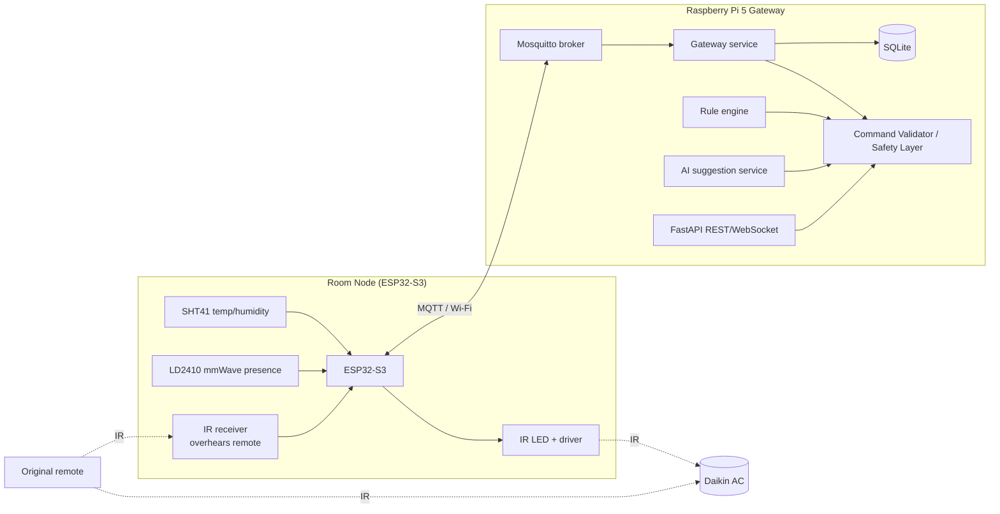

# Architecture

Components marked Safety Layer, Rule engine, AI service and FastAPI are **planned** (Milestones 4–6); Milestone 1 implements the broker, gateway service and SQLite storage.

## Control priority

1. Local human (physical remote, overheard by the IR receiver)
2. App / dashboard
3. Rules (schedules, presence)
4. AI suggestion

A higher level sets a manual-override flag that suppresses lower levels for a configurable time.

## Safety Layer (planned rules)

- Hysteresis ≥ 1 °C; minimum off-time 3–5 min before re-start (compressor protection)
- Rate limit and duplicate-command suppression
- Per-command change limits (±1 °C, one fan step)
- Never cut AC power with a relay; IR only
- State is *expected*, not confirmed (IR is one-way); resynchronised when the remote is overheard

## Data flow

**Telemetry:** sensor → ESP32 plausibility filter (range, ≤5 °C jump) → `home/<room>/telemetry` (QoS 0) → gateway re-validates → SQLite (invalid messages go to `rejected`).

**Command:** source → (Safety Layer) → `home/<room>/command` (QoS 1) → node → IR → `command_result` → gateway stores round-trip time.

**Availability:** node publishes `status=online` (retained); broker publishes `offline` via Last Will if the node vanishes.

## ML plan (Milestone 6)

Offline training (scikit-learn, e.g. Random Forest regression) with the user's manual adjustments as labels; report MAE/RMSE. Deployed as suggestions first (Manual → Suggest → Auto), with explanations, easy override and a Do-Not-Disturb mode.
