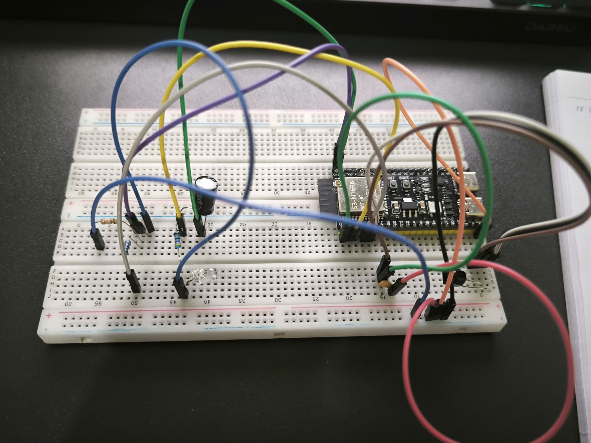

# IR transmit / receive circuit (Room Node)

Status: validated on the bench with an IR loopback test. **Not yet tested on a real Daikin unit or remote.**

## 1. Circuit

```
                 ESP32-S3
             +-------------+
 TSOP38238   |             |
 OUT (1) ----| GPIO 5      |
 VCC (3) ----| 3V3     3V3 |---- 47 Ω ---- LED IR (anode, long leg)
 GND (2) ----| GND         |               LED IR (cathode) ---- C  2N2222A
   100 nF between VCC-GND  |                                       |
   (next to the TSOP)      | GPIO 4 |---- 330 Ω ---------+-------- B
             |             |                        10 kΩ|
             |         GND |----------------------------+--------- E
             +-------------+   100 µF (+ to 3V3) next to the LED
```

| Part | Value | Notes |
|---|---|---|
| IR receiver | TSOP38238 | Chosen over VS1838B by measurement (section 4) |
| Receiver decoupling | 100 nF ceramic, VCC–GND | Next to the receiver pins |
| IR LED | 5 mm, 940 nm | Unknown brand; Vishay TSAL6200 used as reference datasheet |
| LED resistor | 47 Ω | ≈ 37–42 mA from 3V3 (measured 2.0 V across it ⇒ 42 mA) |
| Transistor | 2N2222A (NPN) | **Pinout differs by manufacturer** – measure before fitting |
| Base resistor | 330 Ω (measured 325 Ω) | I_B ≈ 7.7 mA |
| Base pull-down | 10 kΩ, B–GND | Keeps the LED off while GPIO floats during boot/reset |
| Bulk capacitor | 100 µF electrolytic, 3V3–GND | Supplies LED current pulses locally |

The LED is currently powered from the board's 3V3 rail. No external supply is used (see section 6).

## 2. Component calculations

**LED current** (TSAL6200: V_F ≈ 1.35 V @ 100 mA; P2N2222A: V_CE(sat) ≤ 0.3 V):

```
I_LED = (3.3 − 1.35 − 0.2) / 47 ≈ 37 mA       (measured ≈ 42 mA)
```

Within the LED's 100 mA continuous rating. Worst case if GPIO 4 is stuck high: P_R = 0.037² × 47 ≈ 0.06 W, safe for a 1/4 W resistor.

**Base drive** (ESP32-S3 GPIO: I_OH ≈ 40 mA nominal):

```
I_B = (3.3 − 0.8) / 330 ≈ 7.7 mA   →   forced β = I_C / I_B ≈ 5
```

Deep saturation (the datasheet specifies V_CE(sat) at forced β = 10), well within GPIO limits. Switching times (≤ 250 ns) are negligible versus the 26 µs carrier period.

**Carrier:** IRremoteESP8266 default duty cycle 50 % (`kDutyDefault = 50`), so peak current is far below the LED's 200 mA pulsed rating.

**Future (range):** for a real AC several metres away, ~100 mA may be needed: 5 V supply with 33 Ω. Only use a 5 V source that shares ground with the ESP32 and never back-feeds the USB rail.

## 3. Test method

Sketch: [`firmware/tools/ir_loopback/ir_loopback.ino`](../../firmware/tools/ir_loopback/ir_loopback.ino)

The ESP32 sends `Power On, Cool, 26 °C, Fan Auto` (Daikin 280-bit) 20 times, receives its own signal and counts how many decoded states match the sent state byte for byte. Toolchain: ESP32 Arduino core 2.0.17, IRremoteESP8266 2.9.0.

## 4. Results

| Run | Receiver | Change | Correct / 20 |
|---|---|---|---|
| 1 | TSOP38238 | Baseline, LED ~15 cm, RX and TX on the same core | 15 |
| 3 | TSOP38238 | Tolerance 35 % | 12 |
| A | TSOP38238 | LED turned away (reflection only) | 0 |
| B | TSOP38238 | LED covered with paper | 12 |
| D | TSOP38238 | LED 3–5 cm, on axis | 14 |
| E | TSOP38238 | Same as 1, with timing dump | 11 |
| **G** | **TSOP38238** | **Receiver started on core 0** | **17** |
| H | VS1838B | Same as G | 8 |
| C | TSOP38238 | TV remote (NEC), ESP32 not sending | 20 |

No run ever lost the signal completely ("not received" = 0 in all loopback runs). All failures decode as `UNKNOWN` with the same structure.

## 5. Analysis

- **Saturation hypothesis rejected.** Weaker signal made results worse (run A: 0/20), not better.
- **Receiver works with a real remote** (run C: 20/20) → remote eavesdropping is feasible.
- **Interrupts disturb the software carrier.** IRremoteESP8266 generates the 38 kHz carrier in software (`mark()`); the receiver's edge interrupts running on the same core distort it. Moving the receiver to core 0 improved 15 → 17/20. In the product firmware the receiver is **disabled while sending**.
- **Receiver AGC matters for long Daikin frames.** In failed captures one mark near the end of the long third frame is ~80–140 µs short while neighbouring spaces are longer by a similar amount. With the VS1838B, mark widths shrink steadily from ~485 µs (frame 1) to ~410 µs (frame 3) → AGC reduces sensitivity during long, dense bursts. TSOP38238 is clearly better (17 vs 8 / 20).
- Raising decode tolerance does not help (failures exceed 35 %).

Limits: n = 20 per configuration; single board, so distance could not be varied; IR LED brand unknown.

## 6. Incident: breadboard power module failure

An MB102-style module powered by a 12 V / 3 A adapter failed (AMS1117 burst) when it was pulled out of the breadboard while powered. Likely contributors: hot-unplugging, unregulated adapter voltage rising above 12 V at no load (AMS1117 max input ≈ 15 V), and 7 V dissipated as heat in a linear regulator.

Rules adopted:
- Power everything off before plugging/unplugging modules or parts.
- No external supply on the breadboard while the ESP32 is connected to the laptop.
- If 5 V is needed: board 5V/VIN pin, or a module powered through USB; measure adapters before use; common ground mandatory.
- Probe on jumper wire ends, not header pins (a probe once bridged 5V–GND).

## 7. Open items

- [ ] Test with a real Daikin remote (identify protocol variant; measure receive success rate).
- [ ] Test with a real Daikin AC (receive success rate vs distance at 3V3/47 Ω; decide whether 5 V/33 Ω is needed).
- [ ] Self-interference handling in firmware: disable receiver during send + blanking window.

## References

- IRremoteESP8266 wiki – Troubleshooting: https://github.com/crankyoldgit/IRremoteESP8266/wiki/Troubleshooting-
- IRremoteESP8266 `IRsend.h` (kDutyDefault): https://crankyoldgit.github.io/IRremoteESP8266/doxygen/html/IRsend_8h.html
- IRremoteESP8266 discussion #1742 (send/receive on one ESP32): https://github.com/crankyoldgit/IRremoteESP8266/discussions/1742
- IRremoteESP8266 issue #62 (software PWM in `mark()`): https://github.com/crankyoldgit/irremoteesp8266/issues/62
- IRremoteESP8266 issue #2039 (ESP32 core 3.x incompatibility): https://github.com/crankyoldgit/IRremoteESP8266/issues/2039
- Vishay TSAL6200 datasheet: https://www.100y.com.tw/pdf_file/23-VISHAY-TSAL6200.pdf
- onsemi P2N2222A datasheet: https://www.onsemi.com/pdf/datasheet/p2n2222a-d.pdf
- PN2222A datasheet: https://ee6131b.mit.edu/document/pn2222a.pdf
- ESP32-S3 electrical characteristics: https://docs.deneyapkart.org/en/Cards/Deneyap-Kart-1A-v2/Electrical-Specifications-esp32-s3
- ir2mqtt hardware setup: https://steelcuts.github.io/ir2mqtt/hardware-setup.html
- Adafruit IoT IR remote: https://learn.adafruit.com/internet-of-things-infrared-remote
