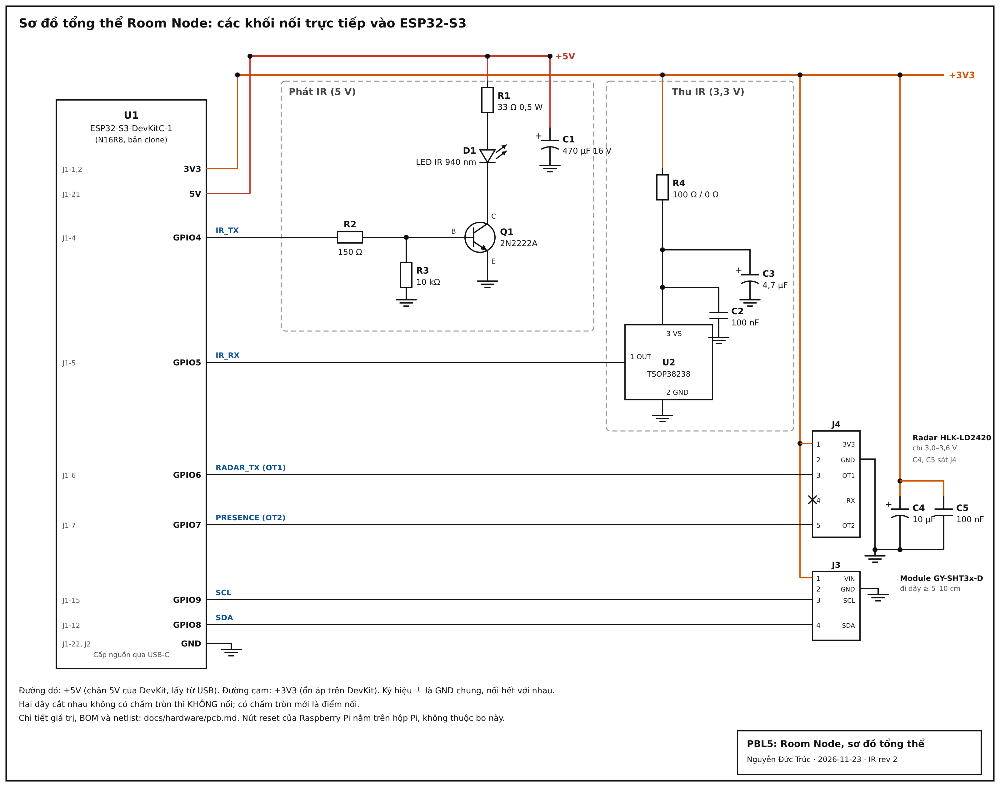
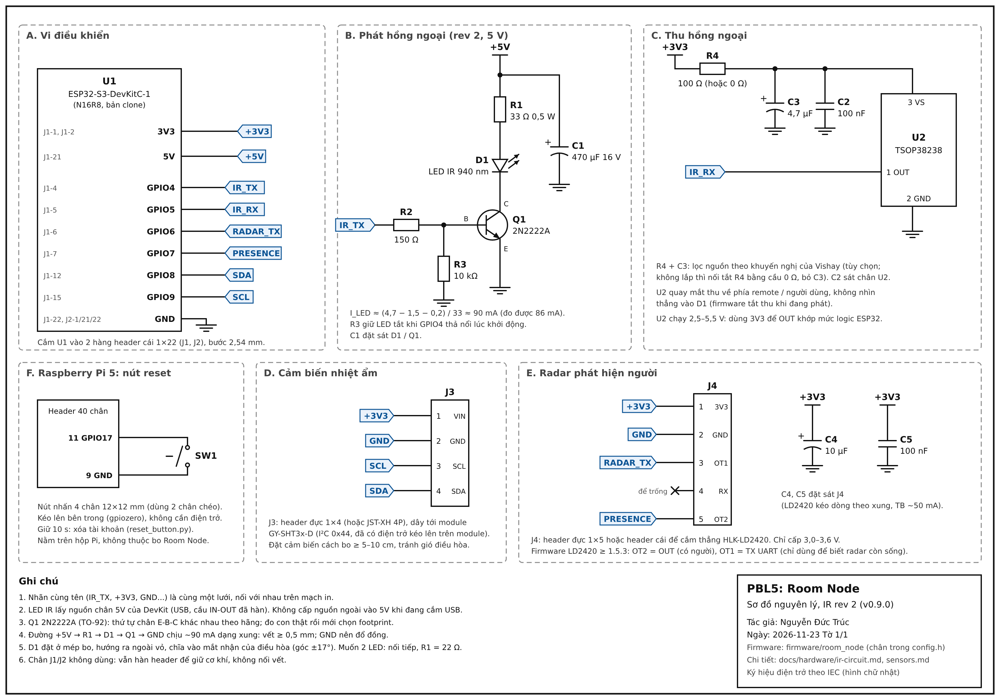

# Room Node: sơ đồ nguyên lý cho mạch in

Hai bản vẽ cùng một mạch:

- **Sơ đồ tổng thể**: mọi khối nối dây thẳng vào ESP32, dễ đọc đường đi của từng tín hiệu.
- **Sơ đồ theo khối**: mỗi khối vẽ riêng, nối với nhau bằng nhãn lưới (cách các phần mềm vẽ mạch in như KiCad, EasyEDA hay dùng).

File gốc dạng vector: [room-node-overview.svg](room-node-overview.svg), [room-node-schematic.svg](room-node-schematic.svg). Mạch in là **bo mang (carrier board)**: ESP32-S3-DevKitC-1 cắm lên qua hai hàng header cái, các linh kiện còn lại hàn trên bo. Chân dùng trong firmware: `firmware/room_node/config.example.h`. Lý do chọn giá trị linh kiện: [ir-circuit.md](ir-circuit.md) (mục 8) và [sensors.md](sensors.md).

## Danh sách linh kiện (BOM)

| Ký hiệu | Linh kiện | Giá trị / mã | Gợi ý footprint |
|---|---|---|---|
| U1 | ESP32-S3-DevKitC-1 (N16R8, clone) | cắm qua J1, J2 | 2 × header cái 1×22, bước 2,54 mm. Khoảng cách 2 hàng: **đo trên board thật** (bản Espressif là 25,4 mm; bản clone có thể khác) |
| J1, J2 | Header cái 1×22 | 2,54 mm | THT |
| U2 | Mắt thu IR | TSOP38238 | THT 3 chân, bước 2,54 mm |
| D1 | LED IR 5 mm | 940 nm (tham chiếu TSAL6200) | LED 5 mm THT, đặt mép bo |
| Q1 | Transistor NPN | 2N2222A (TO-92) | TO-92 inline; **thứ tự E-B-C đo trên con thật** |
| R1 | Điện trở | 33 Ω, **0,5 W** | THT, bước ≥ 10 mm |
| R2 | Điện trở | 150 Ω, 1/4 W | THT hoặc 0805 |
| R3 | Điện trở | 10 kΩ, 1/4 W | THT hoặc 0805 |
| R4 | Điện trở (tùy chọn) | 100 Ω, hoặc cầu 0 Ω | THT hoặc 0805 |
| C1 | Tụ hóa | 470 µF / 16 V | THT, đường kính 8–10 mm, sát D1/Q1 |
| C2 | Tụ gốm | 100 nF | sát chân U2 |
| C3 | Tụ hóa (tùy chọn) | 4,7 µF / 16 V | THT nhỏ |
| C4 | Tụ hóa | 10 µF / 16 V | sát J4 |
| C5 | Tụ gốm | 100 nF | sát J4 |
| J3 | Đầu nối SHT3x | header đực 1×4 hoặc JST-XH 4P | dây ra module GY-SHT3x-D |
| J4 | Đầu nối LD2420 | header 1×5, bước 2,54 mm | radar cắm thẳng hoặc qua dây |

SW1 (nút reset) nằm trên hộp Raspberry Pi, không thuộc bo này.

## Danh sách lưới (netlist)

| Lưới | Nối với |
|---|---|
| +5V | J1-21 (5V của DevKit), R1 chân 1, C1 (+) |
| +3V3 | J1-1, J1-2, R4 chân 1, J3-1, J4-1, C4 (+), C5 |
| GND | J1-22, J2-1, J2-21, J2-22, Q1-E, R3 chân 2, C1 (−), C2, C3 (−), U2-2, J3-2, J4-2, C4 (−), C5 |
| IR_TX | J1-4 (GPIO4), R2 chân 1 |
| (base Q1) | R2 chân 2, R3 chân 1, Q1-B |
| (anot D1) | R1 chân 2, D1 anot |
| (catot D1) | D1 catot, Q1-C |
| (VS U2) | R4 chân 2, C3 (+), C2, U2-3 |
| IR_RX | J1-5 (GPIO5), U2-1 (OUT) |
| RADAR_TX | J1-6 (GPIO6), J4-3 (OT1) |
| PRESENCE | J1-7 (GPIO7), J4-5 (OT2) |
| SDA | J1-12 (GPIO8), J3-4 |
| SCL | J1-15 (GPIO9), J3-3 |
| (không nối) | J4-4 (RX của LD2420) và mọi chân J1/J2 còn lại |

Số chân J1/J2 theo [hướng dẫn ESP32-S3-DevKitC-1 của Espressif](https://docs.espressif.com/projects/esp-dev-kits/en/latest/esp32s3/esp32-s3-devkitc-1/user_guide.html). Mọi chân đang dùng đều nằm trên J1; J2 chỉ để giữ cơ khí và nối GND.

## Lưu ý khi vẽ mạch in

1. **Vòng dòng LED**: +5V → R1 → D1 → Q1 → GND mang xung khoảng 90 mA ở 38 kHz. Giữ vòng này ngắn, vết ≥ 0,5 mm, C1 sát Q1/D1.
2. **GND đổ đồng** cả hai mặt, nối bằng nhiều via.
3. **U2 xa D1** (hoặc có vách chắn), mắt thu quay về phía người dùng; C2 sát chân U2.
4. **LD2420**: không có đồng hoặc linh kiện kim loại phía trước ăng-ten; vỏ hộp bằng nhựa. Nên để J4 ở mép bo, có thể đặt radar đứng.
5. **SHT3x không nằm trên bo**: nhiệt từ ESP32 và radar làm sai số đo; nối bằng dây dài 5–10 cm trở lên.
6. **Cổng USB-C của DevKit** quay ra mép bo để cắm nguồn khi đã lắp vỏ.
7. Lỗ bắt vít M3 ở 4 góc nếu cho vào hộp.
