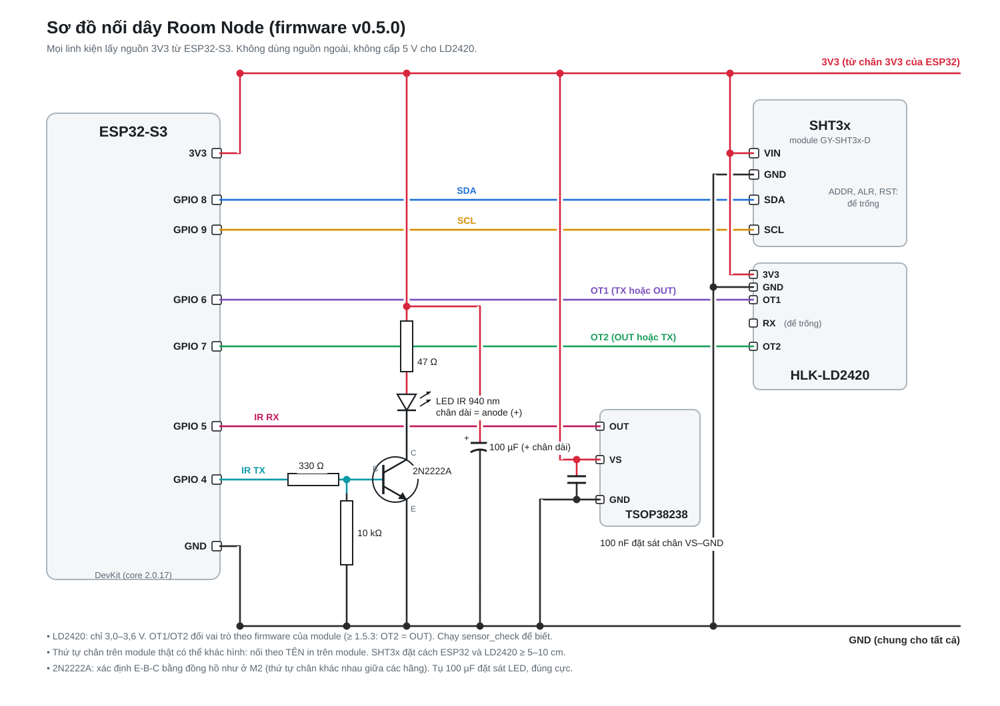

# Cảm biến của Room Node: SHT3x và HLK-LD2420

## Sơ đồ nối dây

Mọi cảm biến lấy nguồn từ chân **3V3** của ESP32-S3. Không cấp 5 V cho LD2420.

| Cảm biến | Chân module | Nối tới ESP32-S3 | Ghi chú |
|---|---|---|---|
| SHT3x (module GY-SHT3x-D) | VIN | 3V3 | Chip SHT3x chạy 2,15–5,5 V; cấp 3V3 để mức I²C khớp ESP32 |
| | GND | GND | |
| | SDA | GPIO 8 | |
| | SCL | GPIO 9 | |
| | ADDR (AD) | để trống | Địa chỉ 0x44. Nối VIN thì thành 0x45 |
| | ALR (ALERT), RST | để trống | Không dùng |
| HLK-LD2420 | 3V3 | 3V3 | **Chỉ 3,0–3,6 V**, dòng trung bình khoảng 50 mA |
| | GND | GND | |
| | OT1 | GPIO 6 | Firmware ≥ 1.5.3: TX (UART). Bản cũ hơn: OUT |
| | OT2 | GPIO 7 | Firmware ≥ 1.5.3: OUT (mức cao = có người). Bản cũ hơn: TX |
| | RX | để trống | Chỉ cần khi muốn cấu hình module qua UART |

Hiện có (từ M2): LED IR qua 2N2222A ở GPIO 4, TSOP38238 ở GPIO 5.

## Vì sao làm như vậy

**SHT3x thay cho SHT41 trong thiết kế ban đầu.** Cùng hãng Sensirion, cùng giao tiếp I²C ở địa chỉ 0x44. Theo trang tổng hợp ở mục Nguồn, SHT30 và SHT31 có cùng độ chính xác danh định ±0,2 °C, ±2 %RH; SHT30 chỉ đảm bảo độ ẩm trong khoảng 10–90 %RH, SHT31 đảm bảo trên cả dải. Firmware hỗ trợ cả SHT3x và SHT4x, chọn bằng `CLIMATE_SENSOR` trong `config.h`.

**LD2420 thay cho LD2410 trong thiết kế ban đầu.** Cũng là radar 24 GHz phát hiện cả người ngồi yên (điều PIR không làm được), nhưng giao thức UART khác hẳn họ LD2410 và chỉ chạy 3,3 V.

**Đọc chân OUT thay vì giải mã UART.** Chân OUT đã cho đúng thông tin cần cho điều khiển và cho dữ liệu AI (có người hay không), không phụ thuộc phiên bản firmware hay chế độ báo cáo của module. UART chỉ được đọc ở mức logic để biết cảm biến còn sống: UART nghỉ ở mức cao, còn khi module mất nguồn hoặc tuột dây thì điện trở kéo xuống trong ESP32 đưa chân về mức thấp. Khi đó node gửi `presence: null` (không biết) thay vì `false` (không có người). Nhờ vậy, một sợi dây lỏng không biến thành dữ liệu sai "phòng trống".

**Vị trí OUT/TX phụ thuộc firmware LD2420.** Từ bản 1.5.3, OT2 là OUT và OT1 là TX ở 115200 baud; các bản cũ hơn đảo lại và dùng 256000 baud (theo tài liệu ESPHome và espboards ở mục Nguồn). Vì vậy cả OT1 lẫn OT2 đều được nối, và công cụ `firmware/tools/sensor_check` cho biết chân nào là chân nào.

**Không gửi dữ liệu giả lập khi đã lắp cảm biến thật.** `CLIMATE_SIM_FALLBACK 0`: nếu SHT3x hỏng hoặc tuột dây, node ngừng gửi telemetry và cứ 30 giây thử khởi động lại cảm biến. Nhờ đó dữ liệu huấn luyện AI không bị lẫn số giả.

**Gửi ngay khi có người vào hoặc ra.** Ngoài chu kỳ 30 giây, node gửi telemetry ngay khi trạng thái hiện diện đổi (đã lọc nhiễu 300 ms, tối đa một lần mỗi giây), để dữ liệu có thời điểm vào/ra chính xác.

## Đặt cảm biến

- **SHT3x cách ESP32, LD2420 và mạch nguồn ít nhất 5–10 cm** (nối bằng dây). ESP32 khi bật Wi-Fi và LD2420 (khoảng 0,17 W) đều tỏa nhiệt, đặt sát sẽ làm nhiệt độ đo cao hơn thực tế.
- **SHT3x không đặt ngay luồng gió điều hòa thổi ra**, không đặt chỗ nắng chiếu. Gió lạnh trực tiếp cho nhiệt độ gió thổi, không phải nhiệt độ phòng.
- **LD2420 hướng về chỗ người hay ngồi hoặc nằm.** Tránh hướng thẳng vào cánh đảo gió của điều hòa, quạt hay rèm bị gió thổi: vật chuyển động có thể gây báo có người sai. Tầm phát hiện người di chuyển khoảng 8 m, cử động nhỏ khoảng 6 m (lắp tường, theo hướng dẫn của Hi-Link).
- Node vẫn phải nhìn thấy mắt nhận IR của điều hòa (M2).

## Giới hạn đã biết

- Thời gian LD2420 giữ trạng thái "có người" sau khi người rời đi ("Target Disappearance Delay") chỉnh được, nhưng hướng dẫn của Hi-Link không ghi giá trị mặc định. Hãy đo bằng `sensor_check` và ghi lại ở bảng dưới.
- Chưa đọc khoảng cách từ UART. Đây là hướng phát triển nếu AI cần thêm đặc trưng này.
- Độ chính xác nhiệt độ thực tế chưa được kiểm chứng với nhiệt kế chuẩn.

## Kết quả đo trên phần cứng

| Hạng mục | Giá trị |
|---|---|
| Chip SHT trên module (đọc chữ trên chip) | SHT3X |
| Địa chỉ I²C | 0x44 |
| Chênh lệch so với nhiệt kế tham chiếu (°C) | chưa đo |
| Firmware LD2420 (theo `sensor_check`: baud, chân OUT) | ≥ 1.5.3, UART 115200, chế độ cơ bản; OUT = OT2 = GPIO 7 |
| Thời gian giữ "có người" sau khi rời đi (s) | ≈ 15–17 s |
| Khoảng cách phát hiện xa nhất khi đi lại (m) | (chưa đo) |
| Phát hiện người ngồi yên đọc sách / nằm (có/không) | (chưa đo) |

## Nguồn

- Hi-Link, *HLK-LD2420 User Manual* V1.3.2: https://www.roboter-bausatz.de/media/90/82/e6/1787563660/HLK-LD2420%20(V.1.3.2).pdf
- ESPHome, *LD2420 24GHz mmWave Radar Sensor*: https://esphome.io/components/sensor/ld2420/ (đổi chân và baud theo firmware). Định dạng dữ liệu UART tham khảo mã nguồn `esphome/components/ld2420/ld2420.cpp`.
- espboards, *LD2420 pinout*: https://www.espboards.dev/sensors/ld2420/
- espboards, *SHT31 / SHT31-D / GY-SHT31*: https://www.espboards.dev/sensors/sht31/
- Sensirion, *SHT31-DIS-B*: https://sensirion.com/products/catalog/SHT31-DIS-B
