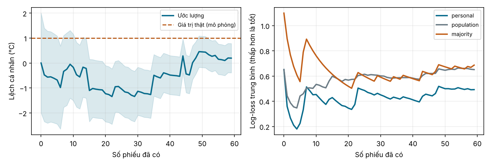

# Đánh giá mô hình cá nhân hóa

Sinh tự động bởi `ml/evaluate_personal.py`. Đừng sửa tay.

> **DỮ LIỆU MÔ PHỎNG.** Phiếu được sinh bởi `ml/simulate_votes.py` (lệch thật 1.0 °C, độ nhạy thật 2.5). Kết quả chỉ chứng minh quy trình hoạt động đúng, không chứng minh mô hình hợp với người thật.

- Dữ liệu: 60 phiếu của phòng `room01` trong 13.7 ngày. Muốn ấm hơn: 2, dễ chịu: 11, muốn mát hơn: 47.
- Cách đánh giá: tuần tự (prequential). Mỗi phiếu được đoán bằng mô hình chỉ học từ các phiếu trước nó.

## Kết quả

| Cách đoán | Accuracy | Macro-F1 | Log-loss |
|---|---|---|---|
| personal | 0.767 | 0.369 | 0.492 |
| population | 0.767 | 0.474 | 0.651 |
| majority | 0.767 | 0.289 | 0.686 |
| band_23_26 | 0.833 | 0.505 | 0.694 |

`personal`: mô hình hệ thống dùng. `population`: chỉ mô hình chung từ ASHRAE. `majority`: lớp người này hay chọn nhất cho tới lúc đó. `band_23_26`: luật cố định.

Ma trận nhầm lẫn của `personal` (hàng: thật, cột: đoán; thứ tự ấm hơn / dễ chịu / mát hơn): `[[0, 1, 1], [0, 2, 9], [0, 3, 44]]`.

## Sở thích đã học

- Lệch so với người trung bình: **+0.23 ± 0.57 °C** (dương: thích ấm hơn). Độ nhạy: 2.23 lần đám đông.
- Ở độ ẩm 58 %: nhiệt độ trung tính 23.6 °C, vùng dễ chịu 22.8–24.5 °C.

