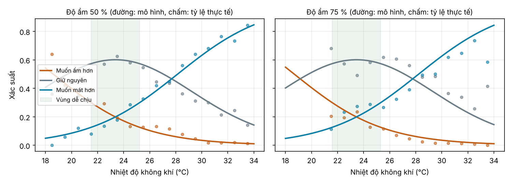

# Mô hình chung (population model)

Sinh tự động bởi `ml/train_prior.py`. Đừng sửa tay.

- Dữ liệu: ASHRAE Global Thermal Comfort Database II v2.1.0 ([DOI 10.6078/D1F671](https://doi.org/10.6078/D1F671)), 20085 phiếu "muốn ấm hơn / giữ nguyên / muốn mát hơn" có nhiệt độ và độ ẩm, ở 262 tòa nhà thuộc vùng khí hậu nhiệt đới và cận nhiệt đới gió mùa.
- Mô hình: hồi quy logistic thứ bậc, đầu vào nhiệt độ không khí và độ ẩm. Tham số: `w_t=0.291` /°C, `w_h=-0.009` /10 %RH, ngưỡng `-2.147`, `0.633`.

## Đánh giá (kiểm định chéo 5 phần, chia theo tòa nhà)

| Cách đoán | Accuracy | Macro-F1 | Log-loss |
|---|---|---|---|
| model | 0.569 | 0.383 | 0.892 |
| majority | 0.505 | 0.223 | 0.989 |
| band_23_26 | 0.516 | 0.442 | 1.043 |

`majority`: luôn đoán lớp phổ biến nhất. `band_23_26`: luật cố định (dưới 23 °C muốn ấm hơn, trên 26 °C muốn mát hơn). Log-loss thấp hơn là tốt hơn; đoán bừa ba lớp đều nhau cho ln 3 ≈ 1,10.

Mô hình chung không đoán được nhiều cho từng người: cùng một nhiệt độ, người này muốn mát hơn, người kia muốn giữ nguyên. Đó là lý do hệ thống cá nhân hóa bằng phiếu của chính người dùng.

## Nhiệt độ dễ chịu theo mô hình chung

| Độ ẩm | Nhiệt độ trung tính | Vùng dễ chịu | Nhiệt độ đặt gợi ý |
|---|---|---|---|
| 40 % | 23.3 °C | 21.5–25.2 °C | 25 °C |
| 60 % | 23.4 °C | 21.5–25.3 °C | 25 °C |
| 80 % | 23.5 °C | 21.6–25.3 °C | 25 °C |

*Nhiệt độ trung tính*: nơi khả năng "muốn ấm hơn" và "muốn mát hơn" bằng nhau. *Vùng dễ chịu*: khả năng muốn đổi theo mỗi hướng không quá 30 %. *Nhiệt độ đặt gợi ý*: mức ấm nhất còn trong vùng dễ chịu, để tiết kiệm điện.

Hệ số độ ẩm gần bằng 0: trong dữ liệu này, độ ẩm gần như không làm đổi mong muốn khi đã biết nhiệt độ. Mô hình vẫn giữ biến này để cá nhân hóa sau.

